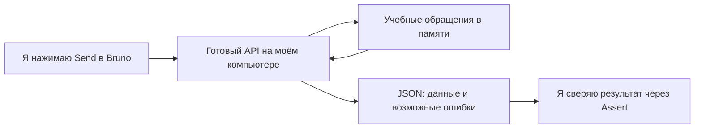

# С чего я начинаю

Я могу читать эту копию без знания серверной разработки. Сначала я работаю готовыми запросами; код открываю, когда хочу понять причину результата.

## За одну минуту я понимаю смысл

Я представляю небольшую службу поддержки. В ней есть обращения клиентов: номер, заголовок, описание, статус и владелец. Я выступаю тестировщиком: проверяю, что клиент читает свои обращения, сотрудник меняет статусы, неправильный ввод отклоняется и запрет не портит данные.

Я использую три части:

Я не строю сайт для клиентов. Я тренирую проверку API — той части приложения, с которой другие программы обмениваются данными. Вместо кнопки создания обращения на сайте я отправляю готовый запрос из Bruno.

## За пять минут я получаю первый результат

1. Я открываю терминал в этой копии, рядом с package.json, и выполняю команды установки и запуска из README.
2. Я оставляю сервер работать в терминале. Надпись с адресом 127.0.0.1:8767/graphql подтверждает успешный запуск.
3. Я открываю папку collection в Bruno, выбираю Local и отправляю 00-health. Я ожидаю `data.health.status: "ok"`.
4. Я открываю Assert: вижу проверяемые утверждения. Я открываю Docs: читаю цель, ожидания и маленький опыт.
5. Я отправляю 01-reset, затем 03-own-ticket. Я вижу своё T-1001 и владельца customer-a. Я пока не меняю код сервера.

Для автоматического знакомства я выполняю `npm run demo` и открываю reports/regression.html. Для этого маршрута отдельный постоянно работающий сервер не нужен.

## За следующие пятнадцать минут я понимаю, что проверять

| Запрос | Что я вижу | Как я это объясняю |
| --- | --- | --- |
| 03 | Объект моего обращения | Я могу читать свою запись |
| 06 | ticket равен null, errors нет | Я запросил несуществующий номер |
| 07 | ticket равен null, есть FORBIDDEN | Я запросил существующую чужую запись |
| 08 | id и title есть, заметка null, есть errors | Я получил разрешённую часть объекта |

Я замечаю: одинаковый HTTP 200 сопровождает разные результаты. Поэтому я проверяю смысл JSON. Подробный разбор я читаю в уроках 1 и 2.

## Как я читаю папки

| Место | Для чего я его открываю | Когда мне это нужно |
| --- | --- | --- |
| collection | Я меняю запросы и проверки в Bruno | С первого дня |
| lessons | Я читаю объяснения, примеры и упражнения | С первого дня |
| src/schema.graphql | Я смотрю допустимые поля | Когда хочу добавить поле в Query |
| src/app.js | Я нахожу причину конкретного ответа | Когда хочу изменить правило стенда |
| src/server.js | Я вижу запуск, порт и флаг дефекта | Когда разбираю запуск |
| tests | Я читаю дополнительные автопроверки | Когда хочу перейти от low-code к коду |
| scripts | Я разбираю автоматический запуск и архив | Когда основной сценарий понятен |
| reports | Я смотрю локальные результаты | После demo или check |
| dist | Я беру полный архив исходников | После package или check |

Я не редактирую node_modules: эта папка содержит установленные библиотеки и пересоздаётся при установке. Я не начинаю с package-lock: это ведомость зависимостей, а не место для изменения правил обращений.

## В каком порядке я учусь дальше

Я читаю урок 1, разбираю запросы 03, 08, 11 и 15 по уроку 2 и выполняю упражнения A–C из урока 5. Затем я открываю app.js с комментариями и урок 3. Я могу остановиться на работе в Bruno: для первых упражнений знание JavaScript не требуется.

Я считаю первый этап освоенным, когда могу объяснить: что отправил, почему ожидал такой ответ, какой Assert это проверяет и какое изменение сделает тест красным. Одного количества зелёных строк мне для понимания недостаточно.
